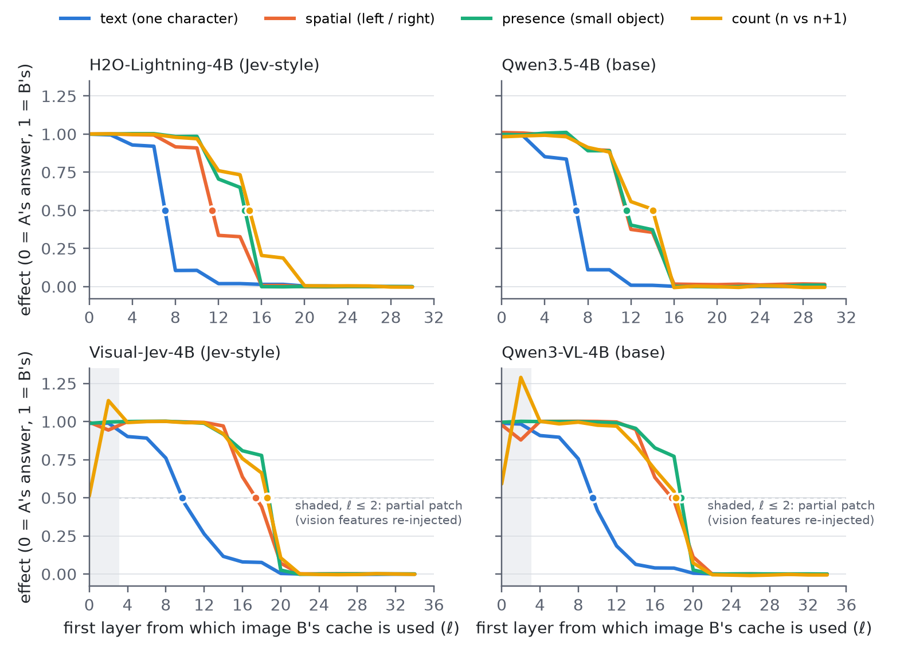
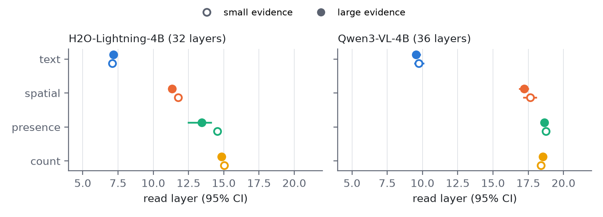

# Results so far

All numbers below are printed by the scripts in this repository. The raw outputs are in
`results/exp1_readout_probes/analysis_output.txt` and `results/exp2_cache_patching/analysis_output.txt`. Methods are
described in [methods.md](methods.md). Every experiment uses synthetic images, so none of these results has yet
been shown on natural images.

---

## Experiment 2: where the image is read (counterfactual cache patching)

### Read and absorb layers

The read layer is where patching the image from that layer onward stops changing the answer by more than half; the
absorb layer is where the question positions already hold the evidence. Values are layer indices with 95% bootstrap
intervals. "Kept" counts the pairs whose two clean images were both answered correctly.

| Skill | H2O-Lightning-4B (32 layers) | Qwen3.5-4B base (32) | Visual-Jev-4B (36) | Qwen3-VL-4B base (36) |
|---|---|---|---|---|
| text | 7.0 [7.0, 7.1] (kept 199) | 6.9 [6.9, 7.0] (198) | 9.7 [9.5, 10.0] (198) | 9.5 [9.3, 9.7] (198) |
| spatial | 11.4 [11.4, 11.5] (195) | 11.5 [11.5, 11.6] (180) | 17.4 [17.1, 17.7] (194) | 17.8 [17.5, 18.0] (193) |
| presence | 14.5 [14.4, 14.5] (200) | 11.6 [11.6, 11.6] (200) | 18.7 [18.7, 18.7] (200) | 18.7 [18.7, 18.7] (200) |
| count | 14.9 [14.8, 15.0] (126) | 14.0 [12.0, 14.3] (61) | 18.6 [18.4, 18.8] (60) | 18.2 [17.9, 18.3] (96) |

Absorb layers (same order of models): text 7.4 / 7.2 / 10.8 / 10.7; spatial 11.3 / 11.3 / 17.2 / 15.7; presence
10.8 / 10.8 / 13.5 / 13.1; count 14.7 / 14.2 / 18.8 / 17.4.

### What we observe

1. **Each skill reads the image in its own band of layers, and text is read first in both model families.** Text is
   read at about a quarter of the depth (22% in the Qwen3.5 models, 26–27% in the Qwen3-VL models). Spatial relations,
   presence and counting are read later, between about a third and just over half of the depth (36–52%). The intervals are far narrower than
   the gaps between skills.
2. **The image stops being read well before the output.** From the layer below onward, the mean late-cache effect of
   every skill stays at or below 0.02. In other words, swapping in the other image's states changes the answer by at
   most 2% of the way.

   | Model | Image no longer read from | At mid-depth, the largest mean effect is still |
   |---|---|---|
   | H2O-Lightning-4B | layer 20 of 32 (62%) | 0.20 (counting, layer 16) |
   | Qwen3.5-4B base | layer 16 of 32 (50%) | 0.02 (layer 16) |
   | Visual-Jev-4B | layer 22 of 36 (61%) | 0.78 (layer 18) |
   | Qwen3-VL-4B base | layer 22 of 36 (61%) | 0.77 (layer 18) |

3. **The finer order of the later skills is family-dependent.** In Qwen3-VL, spatial, presence and counting lie within
   about 1.3 layers of one another; in the Qwen3.5 base, spatial and presence coincide and counting comes later.
4. **Jev-style decision training does not change where the image is read in a way that replicates.** On pairs kept
   by both models (Jev-style model minus its base):

   | Skill | H2O − Qwen3.5 base | Visual-Jev − Qwen3-VL base |
   |---|---|---|
   | text | +0.1 [+0.1, +0.2] (n = 197) | +0.2 [+0.1, +0.3] (n = 197) |
   | spatial | −0.1 [−0.2, −0.0] (n = 177) | −0.4 [−0.6, −0.2] (n = 189) |
   | presence | **+2.9** [+2.8, +2.9] (n = 200) | +0.0 [+0.0, +0.0] (n = 200) |
   | count | **+1.7** [+0.7, +3.0] (n = 41) | −0.3 [−0.6, −0.2] (n = 24) |

   H2O reads presence and counting later than its base, but Visual-Jev shows no comparable shift. The H2O shift is
   therefore specific to H2O's training recipe (text-only decision data, LoRA rank 64, three stages), not a general
   property of Jev-style training.
5. **For presence, the question holds the answer before it stops reading.** Both Qwen3-VL models absorb the evidence
   around layer 13 but keep reading the image until about 18.7. In the Qwen3.5 family this gap appears only after
   H2O's training (absorb 10.8, read 14.5).

### Size control: does the band follow the skill or the size of the evidence?

Each skill was repeated with small and large evidence (100 pairs each).

| Skill | H2O small / large read layer | Qwen3-VL small / large read layer |
|---|---|---|
| text (12 vs 28 px) | 7.1 / 7.2 | 9.7 / 9.5 |
| spatial (20 vs 56 px shapes) | 11.8 / 11.3 | 17.6 / 17.2 |
| presence (20 vs 56 px triangle) | 14.6 / 13.4 | 18.8 / 18.6 |
| count (16–20 vs 40–48 px circles) | 15.0 / 14.9 | 18.4 / 18.5 |

Size moves the read layer by at most 1.1 layers within a skill (H2O presence; every other shift is 0.4 or less). The
size-averaged read layers span 7.8 layers between skills in H2O and 9.1 in Qwen3-VL. Under these conditions, read
depth follows the skill rather than the size of the evidence. Other salience factors (contrast, clutter density, the
number of evidence tokens for counting) are untested.

### Caveats

- **Synthetic stimuli.** The intervals cover the sampling of pairs, not other kinds of images.
- **Selection on correctness.** Only 30–63% of counting pairs survive the filter (61 of 200 for the Qwen3.5 base), so
  the counting curves describe the easier counts.
- **Hybrid architecture.** In Qwen3.5, the Gated DeltaNet layers carry a recurrent state across positions, so a "read
  layer" there mixes attention reads with recurrent transfer. The pure-attention Qwen3-VL replication addresses this.
- **One prompt format and one readout,** a grid of every second layer, and layer-level localisation only (no
  individual attention heads).
- **Prior work.** A related two-stage pattern (image information integrated in lower and middle layers, the answer
  formed later) was reported for LLaVA models with attention knockout (Zhang et al., arXiv 2411.18620).

---

## Experiment 1: is a failure a lost readout or missing evidence?

### Counting, 8-way choice (chance 0.125; 400 test items)

| | Qwen3.5-4B base | H2O-Lightning-4B |
|---|---|---|
| Letter readout (as served) | 0.295 | 0.445 |
| Readout after linear recalibration of the 8 letter logits | 0.565 | 0.652 |
| Best answer-position probe (layer) | 0.530 (28) | 0.608 (32) |
| Best pooled image-token probe | 0.33 | 0.34 |
| Pixel-histogram / shuffled-label controls | 0.22 / 0.12 | 0.22 / 0.14 |
| Signed error of the readout on test items (counts) | −1.17 | −0.64 |
| Readout accuracy at true count 8 / 9 | 0.00 / 0.00 | 0.02 / 0.00 |

The recalibrated letter logits match or beat the hidden-state probe. The readout already carries the information;
its argmax is shifted downward, so the models systematically undercount (worst at 8–9). Writing the options as
words, or as words in reversed order, gives the same picture for H2O (readout 0.448 and 0.440, signed error −0.65
and −0.54). The undercount follows the meaning of the options, not the letters or their positions.

### Readout versus free generation (same images, first 200 items)

| | Readout | Free generation | Only readout right / only generation right |
|---|---|---|---|
| Qwen3.5-4B base, counting (n = 83) | 0.277 | 0.494 | 7 / 25 |
| H2O-Lightning-4B, counting (n = 83) | 0.506 | 0.458 | 9 / 5 |
| Qwen3.5-4B base, text (n = 117) | 0.957 | 0.855 | 16 / 4 |
| H2O-Lightning-4B, text (n = 117) | 0.983 | 0.855 | 16 / 1 |

The base model's letter readout loses to its own free generation on counting, and Jev-style training (H2O) removes
that gap. On reading text, the letter readout beats free generation for both models.

### Small text

- **Fonts 8–14 px are too easy:** readout 0.955 (base) and 0.980 (H2O), probes 1.00.
- **Fonts 5–8 px, fixed codes, 8-way choice:** readout 0.410 (base) and 0.412 (H2O); recalibrated letter logits 0.623
  and 0.728. By font size, H2O's readout is 0.13 / 0.13 / 0.55 / 0.89 at 5 / 6 / 7 / 8 px. When unsure, the readout
  defaults to option A (71% of H2O's answers, 72% of the base model's).

### Random-code control (yes/no, 5–8 px, a different code in every image; chance 0.5)

| | Qwen3.5-4B base | H2O-Lightning-4B |
|---|---|---|
| Readout accuracy (AUC) | 0.668 (0.776) | 0.750 (0.818) |
| Threshold-recalibrated readout | 0.706 | 0.738 |
| Best answer-position probe (AUC) | 0.720 (0.787), layer 24 | 0.742 (0.814), layer 32 |
| Says "yes" | 68% | 44% |

H2O by font size (readout / recalibrated / probe): 5 px 0.54 / 0.56 / 0.62; 6 px 0.76 / 0.72 / 0.61; 7 px
0.82 / 0.81 / 0.84; 8 px 0.90 / 0.88 / 0.90.

### What we observe

1. **When codes cannot be memorised, the answer-position state knows no more than the readout says** (H2O: probe
   0.742, readout 0.750). The hypothesis that the evidence is present but not read out is not supported at the answer
   position. (A probe on the fixed-code version scored higher, but this control shows that came from memorising the
   8 code appearances.)
2. **The answer format matters a great deal.** The same 5–6 px text is at chance in 8-way choice (0.13) but well above
   chance as a yes/no question (0.76 at 6 px).
3. **Jev-style training reduces answer biases.** H2O's yes-rate is 44% against the base model's 68%, and H2O
   undercounts less (signed error −0.64 against −1.17). Small-text accuracy still follows font size in both models.
4. **Decisions form late.** The logit lens finds the option-letter decision only from layer 24 (text) or 27–30
   (counting), although linear probes at the answer position reach their plateau by layers 12–20.

### What experiment 1 does not test

The probes read the answer-position state and *pooled* image-token states. Whether the frozen vision encoder's tokens
at the location of the text still contain the code (a localised, memorisation-proof probe on the encoder output) has
not been measured. That is the next experiment ([roadmap.md](roadmap.md)).
